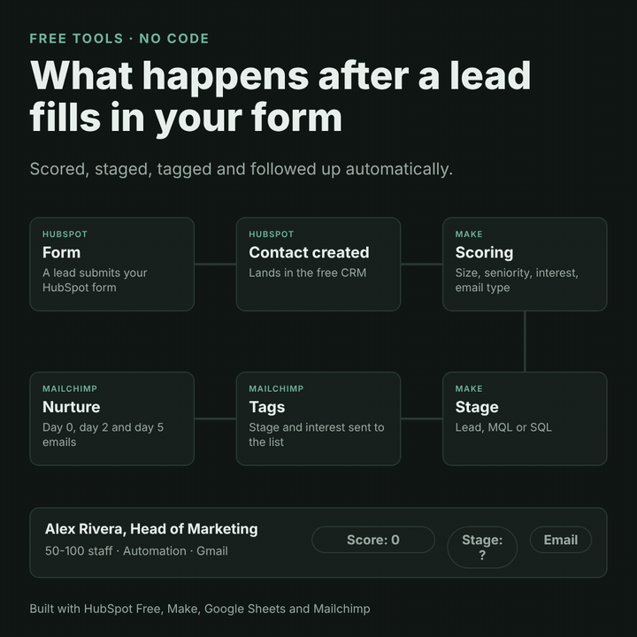
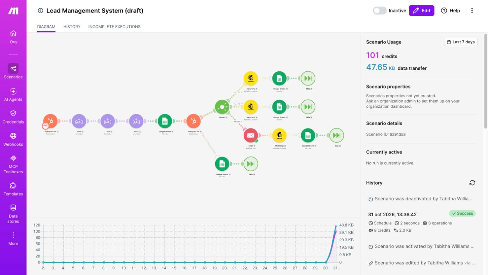
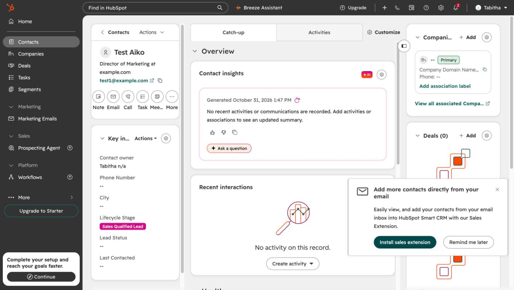
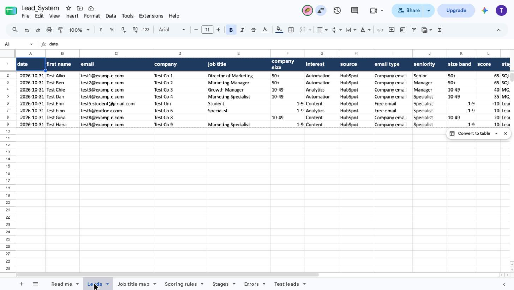
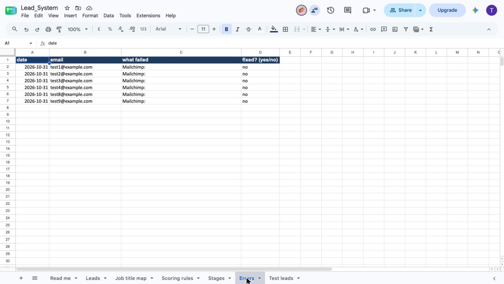
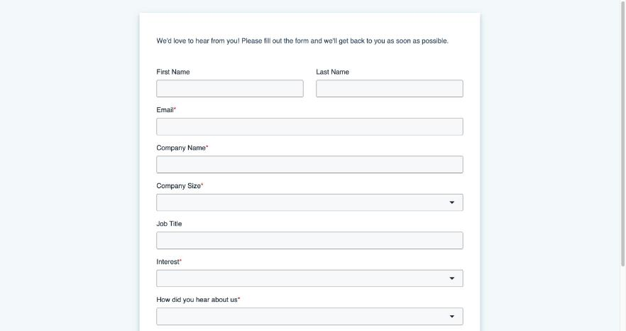
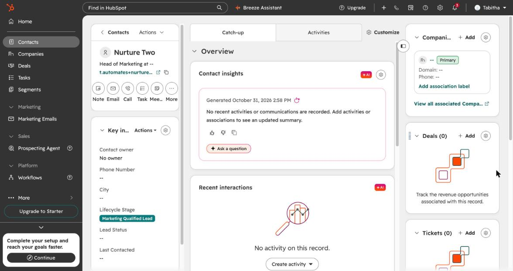
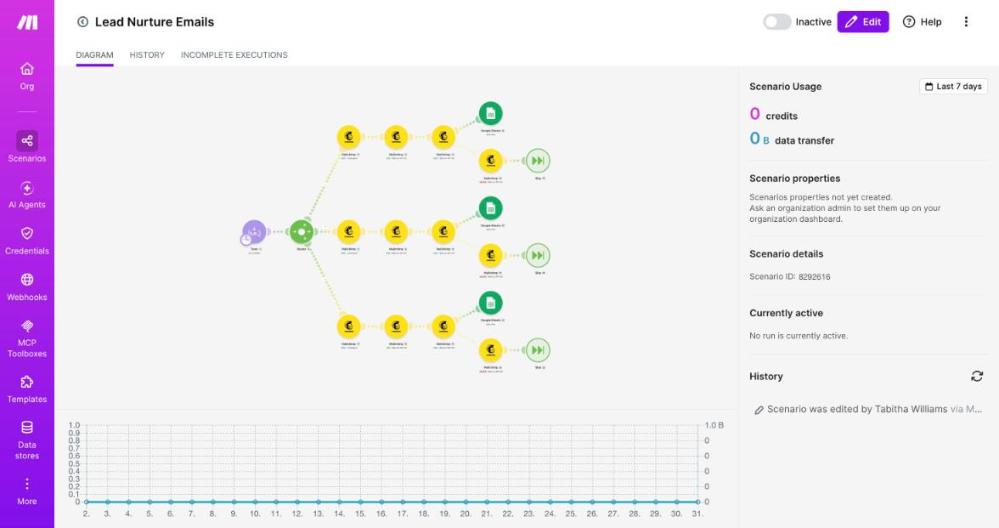
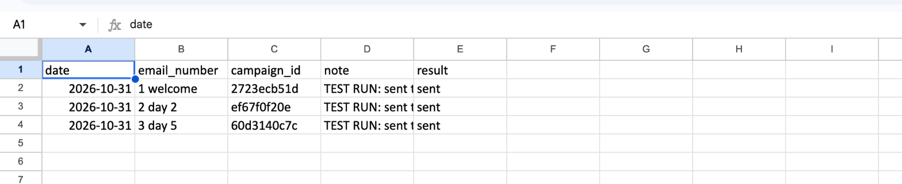
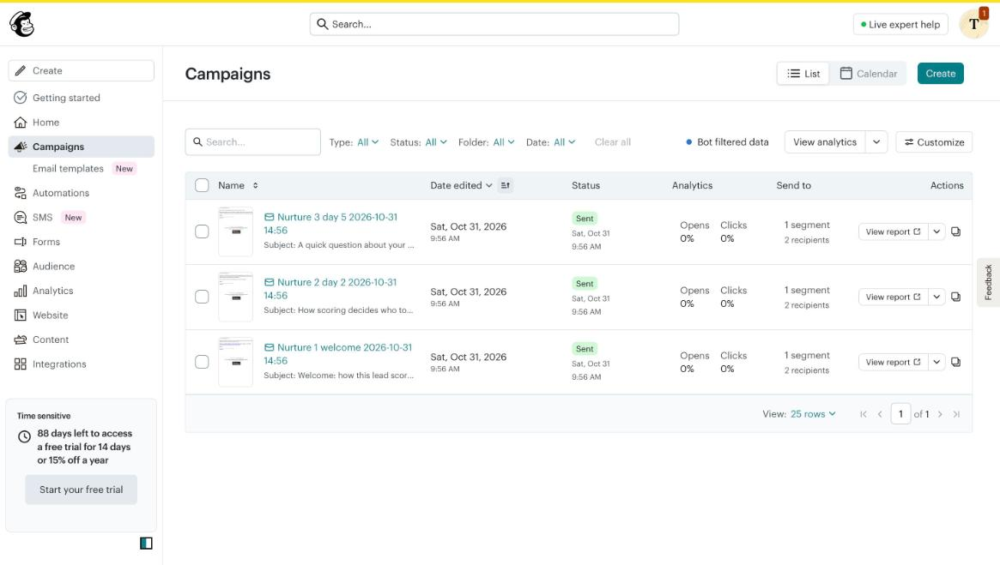

# Lead Capture to Nurture System

A free system for small B2B SaaS teams that takes a lead from a **sign-up form** to a **scored, tagged contact** and a **3-email nurture sequence**. It runs on **HubSpot Free CRM (form and CRM), Make (free), Google Sheets and Mailchimp (free)**. No paid plan or API key is needed.

## Who it is for

Early-stage SaaS teams (a founder, a marketer, a small sales team) that:
- collect leads in HubSpot Free,
- sort and prioritise them by hand, or not at all,
- can't pay for HubSpot workflows or a marketing automation platform yet.

## The problem

Every new lead looks the same in the CRM. Hot leads wait in a list, cold leads get the same attention, nobody follows up with the rest, and nobody can say why a lead was treated the way it was.

## What it does

1. **Captures** the lead with a HubSpot form (name, email, company, size, job title, interest, source).
2. **Scores it** from company size, job seniority, interest and email type.
3. **Sets a stage:** Lead (low), MQL (worth nurturing) or SQL (ready for sales), and saves the score and stage on the HubSpot contact.
4. **Tags it in Mailchimp** by interest and stage and stores the interest in a Mailchimp field, so emails can be tailored.
5. **Alerts you by email** when a lead is sales-ready, with the score breakdown.
6. **Sends a 3-email nurture sequence** (welcome, a tip tailored to the lead's interest after 2 days, a question after 5 days). See [docs/nurture-emails.md](docs/nurture-emails.md).
7. **Logs** every lead and every nurture send in Google Sheets, and records failures in an Errors tab instead of stopping.

## How it helps

- Nobody sorts leads by hand.
- Sales-ready leads are flagged within about 15 minutes.
- Every lead gets follow-up, tailored by interest, without a paid automation tool.
- Everyone uses the same written scoring rules, which you can change.
- Failures are logged, not silent.
- It costs nothing on free plans.

## Cost and limits

The scoring scenario uses about 8 Make operations per lead. The nurture scenario runs once a day and uses about 14 operations a day when there is something to send. On a plan with about 1,000 operations a month, that is roughly 120 leads a month. Free plan limits change, so check Make's pricing page.

> **Status:** tested end to end with dummy data and test addresses. The form-to-score flow and all three nurture emails ran once successfully. The nurture scenario is saved switched off, because it emails every audience member whose signup date matches. It has not been run for a live team yet.

## Workflow

[Static diagram](screenshots/architecture.png) · [MP4 version](screenshots/workflow-animated.mp4)

## Live intake page

The form is embedded on a public landing page that offers early-stage B2B SaaS teams a free lead-routing review: https://149661254.hs-sites-eu1.com/free-lead-routing-review

Submissions go through the same flow described here. The page promises no results and no testimonials.

## Step by step

0. **Capture:** a visitor submits the HubSpot form "Lead Capture", which creates the contact.
1. **Trigger:** Make watches HubSpot for new contacts (every 15 minutes on the free plan).
2. **Clean and classify:** works out the email type (company or free email) and seniority (from job title keywords).
3. **Score:** adds points for company size, seniority, interest and email type (rules below).
4. **Stage:** under 30 = Lead, 30 to 59 = MQL, 60 or more = SQL.
5. **Write back:** saves the score and lifecycle stage on the HubSpot contact.
6. **Log:** adds a row to the `Leads` tab in Google Sheets.
7. **Route:** adds the contact to Mailchimp with an interest tag and a stage tag. SQL leads also trigger an email alert with the score breakdown.
8. **Nurture:** a second Make scenario runs daily. It creates and sends one Mailchimp campaign per email to the audience members whose signup date was today (welcome), 2 days ago (tip) and 5 days ago (question), then logs each send in the `Nurture log` tab.
9. **Handle errors:** a failed HubSpot or Mailchimp step writes the email and failing system to the `Errors` tab and the run continues.

## Scoring rules

| Signal | Value | Points |
| --- | --- | --- |
| Company size | 50+ (form bands 50-100, 100-500, 500-1000, 1000+) | +20 |
| Company size | 10-49 (form bands 5-25, 25-50) | +10 |
| Company size | 1-9 (form band 1-5) | 0 |
| Seniority | Senior (head, director, VP, chief, founder in job title) | +20 |
| Seniority | Manager (manager, lead in job title) | +20 |
| Seniority | Anything else (Specialist) | 0 |
| Interest | Automation | +15 |
| Interest | Analytics or Content | 0 |
| Email | Company email | +10 |
| Email | Free email (gmail, yahoo, outlook, hotmail, icloud) | -10 |

| Score | Stage | HubSpot lifecycle value |
| --- | --- | --- |
| 60 or more | SQL | salesqualifiedlead |
| 30 to 59 | MQL | marketingqualifiedlead |
| under 30 | Lead | lead |

## Test results

I tested the scenario with dummy leads. All scores matched the expected values. Full table in [docs/test-results.md](docs/test-results.md).

| Test lead | Score | Stage |
| --- | --- | --- |
| Director, 50+, Automation, company email | 65 | SQL |
| Manager, 50+, Automation, company email | 65 | SQL |
| Manager, 10-49, Analytics, company email | 40 | MQL |
| Specialist, 10-49, Automation, company email | 35 | MQL |
| Student, 1-9, Content, gmail | -10 | Lead |
| Specialist, 1-9, Analytics, outlook | -10 | Lead |
| Blank job title, 10-49, Content, company email | 20 | Lead |
| Same email as the first lead | rejected by HubSpot | none |

## Form test

I submitted the form with a test lead (Head of Marketing, 50-100 employees, interest Automation, Gmail address). It scored **45** and HubSpot set it to **Marketing Qualified Lead**, as the rules predict (20 size + 20 seniority + 15 interest - 10 free email).

## Screenshots

| | |
| --- | --- |
|  |  |
| The Make scenario | A HubSpot contact with its stage |
|  |  |
| The Leads tab | The Errors tab |
|  |  |
| The HubSpot form | A form lead scored 45 and set to MQL |
|  |  |
| The nurture scenario in Make (three routes, one per email) | The Nurture log tab after the test run |
|  | |
| The three nurture campaigns in Mailchimp, status Sent, 2 test recipients each | |

## How to build your own copy

You need free accounts for HubSpot, Make, Google (Sheets) and Mailchimp. No paid plan or API key is needed. Allow about 3 hours.

1. **Google Sheet.** Upload [sheet/Lead_System_template.xlsx](sheet/Lead_System_template.xlsx) to Google Drive and open it as a Google Sheet. Keep the tab names `Leads` and `Errors`.
2. **HubSpot properties.** In HubSpot go to Settings, Data Management, Properties, Contact properties and create:
   - `lead_score` (Number)
   - `company_size` (Single-line text, values 1-9, 10-49, 50+). The HubSpot form writes the size band to the built-in `numemployees` field instead; the scoring reads either one.
   - `interest` (Dropdown, values Automation, Analytics, Content)
3. **HubSpot form.** Create a form with first name, email, company, company size, job title, interest and source, and turn on "Create new contacts for email addresses". Add a consent checkbox or data privacy field.
4. **Mailchimp.** Create one audience, copy its audience ID, and add a text merge field with the tag `INTEREST`.
5. **Make.** Create a new scenario, open the menu (three dots) and choose **Import Blueprint**, then select [blueprint/lead-scoring-and-routing.blueprint.json](blueprint/lead-scoring-and-routing.blueprint.json). Import [blueprint/lead-nurture-emails.blueprint.json](blueprint/lead-nurture-emails.blueprint.json) as a second scenario.
6. **Reconnect each module.** The blueprint has placeholders. Open every HubSpot, Google Sheets and Mailchimp module, choose your own connection, then choose your own spreadsheet, tab and audience.
7. **Test.** Submit the form with a test address you own (for example a plus-address like you+test1@gmail.com), then run the scoring scenario. To test the nurture emails, copy the nurture scenario, add a segment condition on that test address, and run it once. Check the score in HubSpot and a new row in the Leads tab. Use [docs/test-results.md](docs/test-results.md) to compare your results.
8. **Switch on** the scenario only when you want it to run. On the free plan it uses about 8 operations per lead.

The blueprint contains no passwords or keys. Your own connections stay in your Make account.

## Design decisions

- **Make does the logic.** HubSpot Free has no workflows and Mailchimp Free has limited automations, so Make runs the scoring and the other tools store and send.
- **Scoring in one place.** The rules are explained in [docs/SOP.md](docs/SOP.md) and the same values sit in the `Scoring rules` tab, so a non-technical teammate can see how a score was reached.
- **Duplicates.** HubSpot refuses a second contact with the same email ("Entry must be unique"), so the system relies on that instead of a Sheets lookup.
- **Errors.** Each risky step has an error handler that logs the lead and carries on, so one bad record does not block the rest.

## Known limits

- The `lead` keyword also matches titles like "Lead Generation Specialist", so those score as Manager.
- Seniority and the free-email list are keyword lists. Edit them in the scenario if you need more.
- The trigger only sees new contacts. Changing a contact later does not re-score it.
- HubSpot can refuse to move a lifecycle stage backwards.
- Mailchimp rejects fake-looking addresses (for example example.com). Those leads are logged in the Errors tab.
- Polling runs every 15 minutes at most on the free plan, so scoring is not instant.
- The form has a required consent checkbox, saved to a `Marketing consent` contact property. The nurture scenario does not yet filter on that property, so only add consenting people to the Mailchimp audience.
- The form's Company Name goes to a HubSpot company record, not the contact's company field, so the Leads tab company column can be blank for form leads.
- The nurture scenario uses scheduled Mailchimp campaigns because Mailchimp's free plan has no automations. It emails every audience member whose signup date matches, so keep test addresses out of a live audience. Free-plan sending limits apply.
- The nurture log cannot show recipient counts: Mailchimp calculates them after the campaign is created.
- Not built: SMS, a Slack alert and Salesforce sync.

## What I would improve next

- Make the Make scenario skip contacts whose `Marketing consent` is not ticked.
- Stop the nurture sequence early when a lead replies or becomes SQL.
- Replace the keyword lists with a lookup in the Google Sheet so edits need no change in Make.
