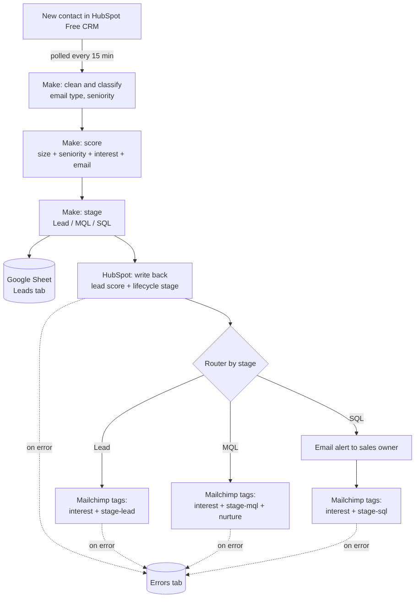
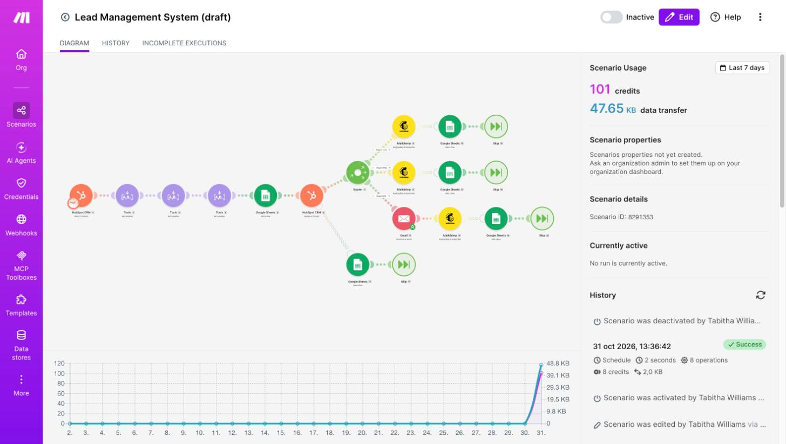
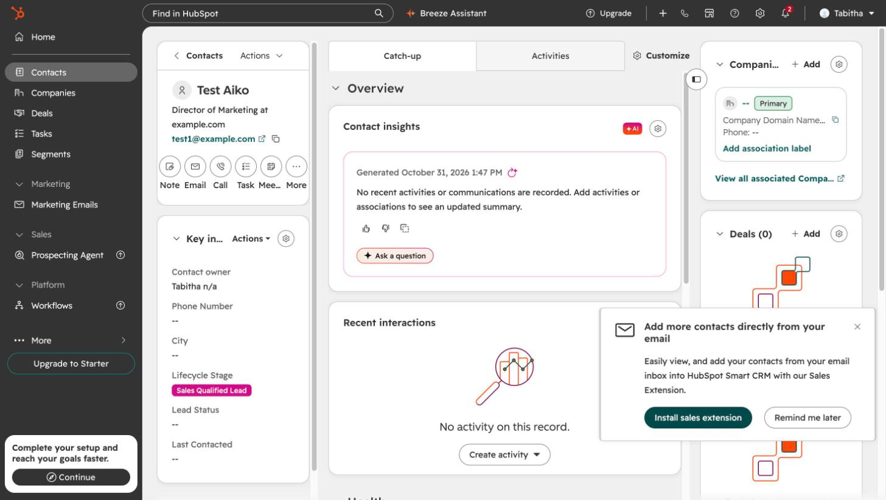
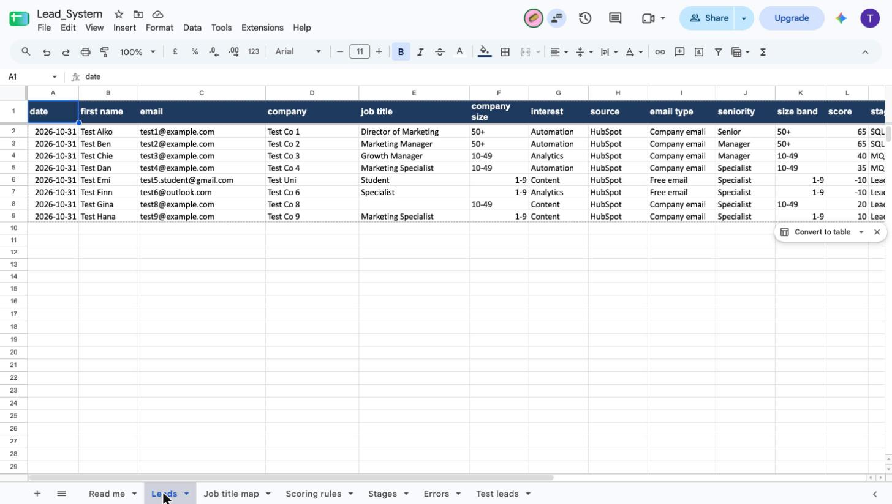
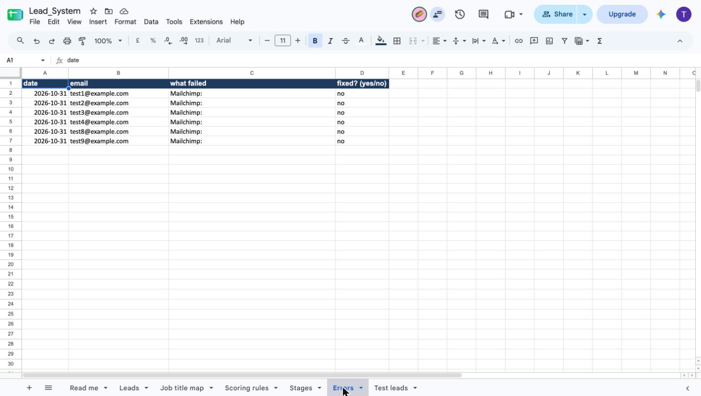

# Lead Management System

A free lead scoring and routing setup for small B2B SaaS teams. It runs on **HubSpot Free CRM, Make (free), Google Sheets and Mailchimp (free)**. No paid plan or API key is needed.

## Who it is for

Early-stage SaaS teams (a founder, a marketer, a small sales team) that:
- collect leads in HubSpot Free,
- sort and prioritise them by hand, or not at all,
- can't pay for HubSpot workflows or a marketing automation platform yet.

## The problem

Every new lead looks the same in the CRM. Hot leads wait in a list, cold leads get the same attention, and nobody can say why a lead was treated the way it was.

## What it does

When a new contact appears in HubSpot, the system automatically:
1. **Scores it** from company size, job seniority, interest and email type.
2. **Sets a stage:** Lead (low), MQL (worth nurturing) or SQL (ready for sales), and saves the score and stage on the HubSpot contact.
3. **Tags it in Mailchimp** by interest and stage, so you can send the right emails.
4. **Alerts you by email** when a lead is sales-ready, with the score breakdown.
5. **Logs every lead** in a Google Sheet.
6. **Records failures** in an Errors tab instead of stopping.

## How it helps

- Nobody sorts leads by hand.
- Sales-ready leads are flagged within about 15 minutes.
- Everyone uses the same written scoring rules, which you can change.
- Failures are logged, not silent.
- It costs nothing on free plans.

## Cost and limits

It uses about 8 Make operations per lead. On a plan with about 1,000 operations a month, that is roughly 120 leads a month. Free plan limits change, so check Make's pricing page.

> **Status:** tested end to end with dummy data. It has not been run for a live team yet.

## Step by step

1. **Trigger:** Make watches HubSpot for new contacts (every 15 minutes on the free plan).
2. **Clean and classify:** works out the email type (company or free email) and seniority (from job title keywords).
3. **Score:** adds points for company size, seniority, interest and email type (rules below).
4. **Stage:** under 30 = Lead, 30 to 59 = MQL, 60 or more = SQL.
5. **Write back:** saves the score and lifecycle stage on the HubSpot contact.
6. **Log:** adds a row to the `Leads` tab in Google Sheets.
7. **Route:** adds the contact to Mailchimp with an interest tag and a stage tag. SQL leads also trigger an email alert with the score breakdown.
8. **Handle errors:** a failed HubSpot or Mailchimp step writes the email and failing system to the `Errors` tab and the run continues.

## Scoring rules

| Signal | Value | Points |
| --- | --- | --- |
| Company size | 50+ | +20 |
| Company size | 10-49 | +10 |
| Company size | 1-9 | 0 |
| Seniority | Senior (head, director, VP, chief, founder in job title) | +20 |
| Seniority | Manager (manager, lead in job title) | +20 |
| Seniority | Anything else (Specialist) | 0 |
| Interest | Automation | +15 |
| Interest | Analytics or Content | 0 |
| Email | Company email | +10 |
| Email | Free email (gmail, yahoo, outlook, hotmail, icloud) | -10 |

| Score | Stage | HubSpot lifecycle value |
| --- | --- | --- |
| 60 or more | SQL | salesqualifiedlead |
| 30 to 59 | MQL | marketingqualifiedlead |
| under 30 | Lead | lead |

## Test results

I tested the scenario with dummy leads. All scores matched the expected values. Full table in [docs/test-results.md](docs/test-results.md).

| Test lead | Score | Stage |
| --- | --- | --- |
| Director, 50+, Automation, company email | 65 | SQL |
| Manager, 50+, Automation, company email | 65 | SQL |
| Manager, 10-49, Analytics, company email | 40 | MQL |
| Specialist, 10-49, Automation, company email | 35 | MQL |
| Student, 1-9, Content, gmail | -10 | Lead |
| Specialist, 1-9, Analytics, outlook | -10 | Lead |
| Blank job title, 10-49, Content, company email | 20 | Lead |
| Same email as the first lead | rejected by HubSpot | none |

## Screenshots

| | |
| --- | --- |
|  |  |
| The Make scenario | A HubSpot contact with its stage |
|  |  |
| The Leads tab | The Errors tab |

## How to build your own copy

You need free accounts for HubSpot, Make, Google (Sheets) and Mailchimp. No paid plan or API key is needed. Allow about 2 hours.

1. **Google Sheet.** Upload [sheet/Lead_System_template.xlsx](sheet/Lead_System_template.xlsx) to Google Drive and open it as a Google Sheet. Keep the tab names `Leads` and `Errors`.
2. **HubSpot properties.** In HubSpot go to Settings, Data Management, Properties, Contact properties and create:
   - `lead_score` (Number)
   - `company_size` (Single-line text, values 1-9, 10-49, 50+)
   - `interest` (Dropdown, values Automation, Analytics, Content)
3. **Mailchimp.** Create one audience and copy its audience ID.
4. **Make.** Create a new scenario, open the menu (three dots) and choose **Import Blueprint**, then select [blueprint/lead-management-system.blueprint.json](blueprint/lead-management-system.blueprint.json).
5. **Reconnect each module.** The blueprint has placeholders. Open every HubSpot, Google Sheets and Mailchimp module, choose your own connection, then choose your own spreadsheet, tab and audience.
6. **Test.** Run the scenario once, create a test contact in HubSpot (Contacts, Create contact), then run it again. Check the score in HubSpot and a new row in the Leads tab. Use [docs/test-results.md](docs/test-results.md) to compare your results.
7. **Switch on** the scenario only when you want it to run. On the free plan it uses about 8 operations per lead.

The blueprint contains no passwords or keys. Your own connections stay in your Make account.

## Design decisions

- **Make does the logic.** HubSpot Free has no workflows and Mailchimp Free has limited automations, so Make runs the scoring and the other tools store and send.
- **Scoring in one place.** The rules are explained in [docs/SOP.md](docs/SOP.md) and the same values sit in the `Scoring rules` tab, so a non-technical teammate can see how a score was reached.
- **Duplicates.** HubSpot refuses a second contact with the same email ("Entry must be unique"), so the system relies on that instead of a Sheets lookup.
- **Errors.** Each risky step has an error handler that logs the lead and carries on, so one bad record does not block the rest.

## Known limits

- The `lead` keyword also matches titles like "Lead Generation Specialist", so those score as Manager.
- Seniority and the free-email list are keyword lists. Edit them in the scenario if you need more.
- The trigger only sees new contacts. Changing a contact later does not re-score it.
- HubSpot can refuse to move a lifecycle stage backwards.
- Mailchimp rejects fake-looking addresses (for example example.com). Those leads are logged in the Errors tab.
- Polling runs every 15 minutes at most on the free plan, so scoring is not instant.
- Not built: a HubSpot form (the free plan limits custom fields), a Mailchimp welcome automation, a Slack alert and Salesforce sync.

## What I would improve next

- Add a form so leads arrive with a source and a consent checkbox.
- Add a daily scenario that sends nurture emails 2 and 5 days after signup.
- Replace the keyword lists with a lookup in the Google Sheet so edits need no change in Make.
